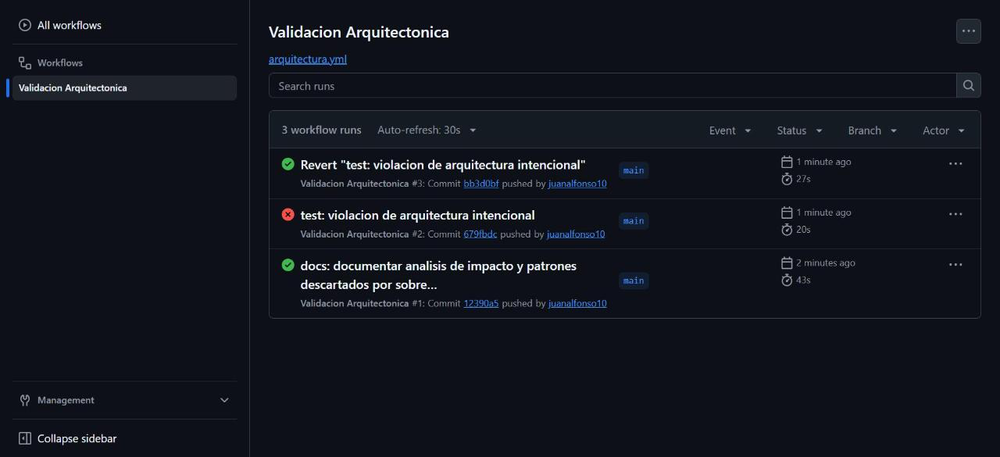
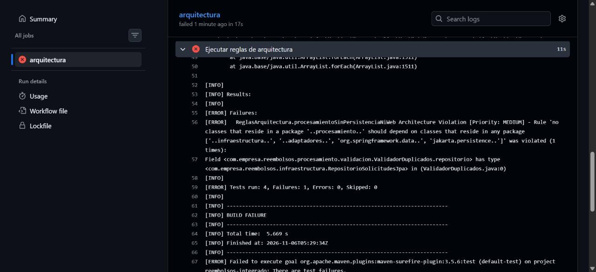

# Sistema de Solicitudes de Reembolso de Gastos Corporativos


Proyecto integrador de la Unidad 12 de Patrones de Diseño de Software. El área de Finanzas
reemplaza una hoja de cálculo compartida por un sistema propio: los empleados registran
solicitudes de reembolso (categoría, monto, fecha y documentos soporte), el sistema las
valida, calcula el monto aprobado y avisa a los interesados cuando cambian de estado.

## Diseño Propuesto

Esta sección se escribió antes de implementar cualquier patrón (primer commit del
repositorio). Para cada requisito se identificó qué varía, qué patrón lo resuelve y por qué
ese y no otro, aplicando el test de explicabilidad de la Guía (sección 1.2): si la razón no
cabe en una oración, el patrón probablemente sobra.

| Requisito | Qué varía (punto de variabilidad) | Patrón | Justificación en una oración |
|---|---|---|---|
| **RF1** Validación en varias etapas | El conjunto de verificaciones que debe pasar una solicitud, que hoy son tres y Finanzas ya anunció que crecerá | **Chain of Responsibility** | Cada verificación es un eslabón independiente que aprueba y delega al siguiente o rechaza y corta la cadena, así que una verificación nueva es un eslabón nuevo sin tocar los existentes. |
| **RF2** Cálculo por categoría | La fórmula del monto aprobado, distinta para cada categoría (viaje, representación, capacitación) y con categorías nuevas en camino | **Strategy** | Cada categoría tiene una fórmula intercambiable que se elige una sola vez por el valor de la categoría, así que una categoría nueva es una clase nueva sin modificar el cálculo de las demás. |
| **RF3** Notificación a varios interesados | Quiénes se enteran de un cambio de estado y cómo reacciona cada uno (empleado, Contabilidad, auditoría, y pronto un panel de métricas) | **Observer** | El servicio publica el cambio de estado a una lista de observadores que no conoce en detalle, y cada uno decide su reacción, así que un interesado nuevo es un observador más. |

**Por qué no otros patrones para el mismo requisito:**

- **RF1 no es Strategy.** No se elige *una* verificación: deben pasar *todas*, en secuencia,
  y la primera que falla decide el resultado. Esa es la forma de Chain of Responsibility.
- **RF2 no es State.** La categoría de una solicitud no cambia con el tiempo ni tiene
  transiciones; es un valor discreto que selecciona una fórmula. Tampoco es Chain of
  Responsibility, porque exactamente una fórmula aplica y no importa el orden.
- **RF3 no es Chain of Responsibility.** Ante un cambio de estado no basta con que *un*
  interesado lo maneje: deben enterarse *todos*, cada uno a su manera.

**Detalles de diseño previstos:**

- La cadena de RF1 tendrá un eslabón inicial que verifique que la solicitud trae los datos
  obligatorios (empleado, categoría, monto positivo y fecha), para que ningún validador
  posterior reciba valores nulos.
- La clase base de la cadena usará un Template Method interno (`validar` fija el recorrido
  y cada eslabón implementa solo `validarPropio`). No es un requisito de diseño aparte, sino
  la forma de no repetir la lógica de delegación en cada eslabón.
- El dominio (`SolicitudReembolso`, `CategoriaGasto`, `EstadoSolicitud`) no dependerá de
  Spring ni de JPA. Los patrones vivirán en `procesamiento/` y solo el servicio de
  aplicación conocerá la persistencia.

## Decisiones de diseño

**Decisión de diseño 1 — orden de la cadena: datos completos → documentos → monto →
duplicados.** El criterio es costo creciente, porque el primer rechazo corta la cadena. Las
verificaciones que solo miran la propia solicitud son constantes y baratas (comparar nulos, un
booleano, un tope). `ValidadorDuplicados` es la única que recorre la lista de solicitudes
pendientes del empleado, así que va al final: solo se ejecuta para las solicitudes que ya pasaron
todo lo demás.

- **Lo que se gana:** una solicitud sin documentos o fuera de tope se rechaza sin recorrer
  ninguna lista. Además, `ValidadorDatosCompletos` va primero por una razón más fuerte que el
  costo: los demás eslabones asumen categoría, monto y fecha no nulos, y ponerlo al inicio
  garantiza que nunca reciban un nulo.
- **Lo que se pierde:** el empleado ve un solo motivo a la vez. Una solicitud duplicada y sin
  documentos se rechaza primero por documentos; al corregirlo, recién se entera de que estaba
  duplicada. Con cualquier orden pasaría lo mismo con alguna combinación, porque la cadena corta
  en el primer rechazo.
- **Matiz honesto:** el ahorro es en la comparación, no en la consulta. El servicio carga las
  pendientes del empleado antes de recorrer la cadena, así que esa consulta a la base de datos
  se paga siempre. Diferirla exigiría pasar un `Supplier` a la cadena; no se hizo porque cada
  empleado tiene pocas solicitudes pendientes (ver "Qué se descartó y por qué").

**Decisión de diseño 2 — selección de la calculadora con un mapa construido desde
`List<CalculadoraReembolso>`, no con un `switch`.** RF2 exige agregar categorías sin modificar el
cálculo existente. Con el mapa, una categoría nueva es una clase nueva anotada con `@Component`:
Spring la inyecta en la lista y `SelectorCalculadora` la registra sola, sin tocar una línea de
las calculadoras ni del selector. Con un `switch`, cada categoría nueva obligaría a editar el
método de selección, que es justamente la clase de cambio que RF2 quiere evitar. El mapa además
falla al arrancar si dos calculadoras declaran la misma categoría (`IllegalStateException`), en
lugar de elegir una en silencio.

Siendo precisos con el alcance: una categoría nueva ("bienestar") también requiere agregar la
constante a `CategoriaGasto` y su tope a `ValidadorMontoMaximo`. Ninguno de los dos cambios toca
el cálculo de las categorías existentes, que es lo que pide RF2. Si se olvida el tope, el
validador rechaza la solicitud con "No hay un tope configurado para la categoria BIENESTAR" en
lugar de fallar con un error interno.

**Decisión de diseño 3 — capas simples para la persistencia; ningún cambio en la notificación
(ADR-001).** `SolicitudReembolsoService` sigue usando `RepositorioSolicitudesJpa` directamente,
sin un puerto intermedio, porque no hay ningún plan de cambiar el motor de base de datos y el
criterio de la Guía (sección 6.2: sistemas que vivirán 3 años o más con cambios de
infraestructura) no se cumple para esa dependencia. Para la notificación sí hay un cambio con
fecha, la API externa de Contabilidad el próximo trimestre, pero `ObservadorCambioEstado` ya es el
punto de extensión que ese cambio necesita. El razonamiento completo, con las alternativas
evaluadas, está en [`docs/adr/ADR-001.md`](docs/adr/ADR-001.md) y se resume más abajo.

**Decisión de diseño 4 — la Regla 1 prohíbe acceso a datos y web, no todo `org.springframework`.**
Los validadores, calculadoras y notificadores usan `@Component`, y eso es aceptable en
`procesamiento` por dos razones:

- **Una anotación de estereotipo es metadato de registro, no comportamiento.** No cambia lo que
  hace la clase ni la ata a una tecnología de entrada o salida. Prueba de ello: todas las pruebas
  unitarias de `procesamiento` crean estas clases con `new`, sin levantar Spring.
- **El acceso a datos y la web sí acoplan la lógica.** Clases como `JpaRepository`,
  `EntityManager` o las anotaciones de `jakarta.persistence` atan la regla de negocio a una base de
  datos; `ResponseEntity` o `HttpStatus` la atan a HTTP. Eso es lo que `procesamiento` debe evitar:
  sus reglas tienen que poder ejecutarse sin base de datos ni servidor web. Por eso la regla
  prohíbe `org.springframework.data..`, `jakarta.persistence..`, `org.springframework.web..` y
  `org.springframework.http..`, además de los paquetes `infraestructura` y `adaptadores` del
  proyecto.

Prohibir todo `org.springframework` obligaría a quitar las 12 anotaciones `@Component` del paquete
y a registrar cada bean a mano en una clase `@Configuration`. Sería más código y más puntos de
falla, sin ganar independencia real.

## Resumen de ADR-001

| | |
|---|---|
| **Decisión** | Capas simples: el servicio usa `RepositorioSolicitudesJpa` sin puerto intermedio; la notificación queda como está |
| **Alternativas evaluadas** | A) Hexagonal completa; B) puerto solo para la persistencia; C) capas simples apoyadas en el seam de notificación (elegida) |
| **Persistencia** | No hay cambio de motor previsto, así que un puerto sería una abstracción especulativa (YAGNI). Si se necesita, el costo está acotado: un solo servicio usa el repositorio y el dominio ya es independiente de JPA (`orm.xml`) |
| **Notificación** | La API de Contabilidad del próximo trimestre se implementará como un `ObservadorCambioEstado` en `infraestructura`, que reemplazará a `NotificadorContabilidad`, sin modificar el servicio ni los demás observadores |
| **Consecuencia negativa aceptada** | Un cambio de motor de base de datos obligaría a introducir el puerto de forma retroactiva; además, la asimetría puede parecer inconsistente a quien no lea el ADR |
| **Revisar si** | Se aprueba otro motor o un segundo almacenamiento, o el servicio necesita probarse sin Spring Data |

## Qué se descartó y por qué

Criterio aplicado (Guía, sección 4.2): ¿la variabilidad que justificaría la alternativa es real
y está documentada hoy, o es especulación sobre un futuro que aún no llegó? Cada descarte es una
decisión vigente hoy, no definitiva, y lleva la señal que obligaría a revisarla.

### Ejemplos de referencia del enunciado

**`ApplicationEventPublisher` en vez de una lista de observadores inyectada.** Se consideró
publicar un evento de dominio con `ApplicationEventPublisher` y `@EventListener` (Guía, sección
2.3). Se descartó porque, con tres observadores fijos y conocidos en tiempo de compilación, el bus
de eventos genérico no aporta desacoplamiento real (ya lo da la interfaz `ObservadorCambioEstado`)
y sí dificulta rastrear quién reacciona a qué cambio. *Señal para reconsiderar:* que algún
interesado necesite reaccionar de forma asíncrona o fuera de la transacción, o que los
interesados vivan en módulos que no deban conocerse.

**Visitor o Abstract Factory para exportar reportes en varios formatos.** Se consideró anticipar
exportaciones en PDF y Excel además de CSV. Se descartó porque hoy solo existe el requisito de
CSV: no hay una segunda petición real de otro formato, así que no se cumple la Rule of Three.
*Señal para reconsiderar:* que Contabilidad pida formalmente un segundo formato.

### Elementos propios de esta implementación

**1. State para las transiciones de `EstadoSolicitud`.** Al implementar `cambiarEstado` fue
tentador modelar cada estado como una clase (PENDIENTE, APROBADA, RECHAZADA, REQUIERE_CORRECCION)
con las transiciones válidas encapsuladas, para impedir, por ejemplo, volver de APROBADA a
PENDIENTE. Se descartó porque ningún requisito define transiciones prohibidas ni un
comportamiento que dependa del estado: RF3 solo pide avisar del cambio. El patrón no pasa el test
de explicabilidad, porque para justificarlo en una oración habría que inventar reglas que
Finanzas no pidió (YAGNI). *Señal para reconsiderar:* que Finanzas defina transiciones válidas
(por ejemplo, "una solicitud aprobada no se puede rechazar") o acciones que solo apliquen en
ciertos estados ("solo una solicitud en REQUIERE_CORRECCION se puede editar").

**2. Una clase `PoliticaDeTopes` compartida por validación y cálculo.** Los topes aparecen dos
veces: 150 000 diarios en `ValidadorMontoMaximo` y en `CalculadoraViaje`, 2 000 000 en
`ValidadorMontoMaximo` y en `CalculadoraRepresentacion`, 3 000 000 en `ValidadorMontoMaximo` y en
`CalculadoraCapacitacion`. Se consideró centralizarlos en una clase o en configuración. Se
descartó porque cada valor aparece exactamente dos veces y es estable: no se cumple la Rule of
Three, y una abstracción nueva acoplaría dos paquetes (`validacion` y `calculo`) que hoy son
independientes. *Señal para reconsiderar:* un tercer lugar que necesite los topes (por ejemplo,
un reporte que muestre el saldo disponible), o que Finanzas quiera cambiarlos sin recompilar, lo
que llevaría a externalizarlos con `@ConfigurationProperties`.

**3. Consulta diferida de las solicitudes pendientes (`Supplier`).** Como el servicio carga las
pendientes del empleado antes de ejecutar la cadena, la consulta se paga aunque la solicitud se
rechace en el primer eslabón (Decisión de diseño 1). Se consideró pasar un
`Supplier<List<SolicitudReembolso>>` para consultar solo si se llega a `ValidadorDuplicados`. Se
descartó porque cambia la firma de todos los eslabones para optimizar una consulta filtrada por
empleado que devuelve muy pocas filas: es optimizar sin una medición que lo pida. *Señal para
reconsiderar:* que una medición muestre esa consulta como cuello de botella, o que los empleados
acumulen muchas solicitudes pendientes.

## Arquitectura resultante

```
com.empresa.reembolsos
├── dominio/             SolicitudReembolso, CategoriaGasto, EstadoSolicitud   (Java puro: sin Spring ni JPA)
├── procesamiento/
│   ├── validacion/      Chain of Responsibility: ValidadorSolicitud + 4 eslabones, CadenaValidadores
│   ├── calculo/         Strategy: CalculadoraReembolso + 3 calculadoras, SelectorCalculadora
│   └── notificacion/    Observer: ObservadorCambioEstado + 3 notificadores
├── aplicacion/          SolicitudReembolsoService (coordina los patrones), excepciones de aplicación
├── infraestructura/     RepositorioSolicitudesJpa (Spring Data JPA)
└── adaptadores/rest/    SolicitudReembolsoController (POST /api/solicitudes, PUT /api/solicitudes/{id}/estado)
src/main/resources/META-INF/orm.xml   mapeo JPA de SolicitudReembolso
```

Las dependencias van en un solo sentido: `adaptadores → aplicacion → procesamiento → dominio`, y
`aplicacion → infraestructura → dominio`. `procesamiento` nunca toca la persistencia:
`ValidadorDuplicados` recibe la lista de solicitudes pendientes ya cargada por el servicio.

**El dominio sin JPA y el repositorio con JPA.** El enunciado pide dos cosas que a primera vista
chocan: que el modelo de dominio no importe nada de Spring ni de JPA, y que
`RepositorioSolicitudesJpa` extienda `JpaRepository<SolicitudReembolso, Long>`, lo que exige que
`SolicitudReembolso` sea una entidad. Se resolvió con el mapeo XML estándar de JPA:
`META-INF/orm.xml` declara la entidad, su tabla, el id autogenerado y los enums como texto, y
`spring.jpa.mapping-resources` lo carga. La clase de dominio queda como Java puro y el
repositorio sigue siendo un `JpaRepository` directo, sin puertos ni mappers.

## Reglas de arquitectura y pipeline

`ReglasArquitectura` (ArchUnit) verifica los límites que sí existen, sin asumir puertos de
persistencia (coherente con ADR-001):

| Regla | Qué protege |
|---|---|
| `procesamientoSinPersistenciaNiWeb` | `procesamiento` no depende de `infraestructura`, `adaptadores`, Spring Data, JPA ni de la capa web de Spring |
| `controladorSoloUsaServicio` | El controlador solo usa la aplicación, el dominio, Spring Web/HTTP y el JDK; nunca el repositorio ni los patrones |
| `calculadorasImplementanInterfaz` | Toda clase `Calculadora*` de `procesamiento.calculo` es una estrategia `CalculadoraReembolso` |
| `notificadoresImplementanInterfaz` | Toda clase concreta de `procesamiento.notificacion` es un `ObservadorCambioEstado` |

**El pipeline.** `.github/workflows/arquitectura.yml` corre en cada push y pull request a `main`:
primero `mvn test -Dtest=ReglasArquitectura` y luego `mvn verify` con la suite completa. Para
comprobar que de verdad detecta violaciones, se subió el commit
`test: violacion de arquitectura intencional`, que inyecta `RepositorioSolicitudesJpa` en
`ValidadorDuplicados`. El job falló en el paso de las reglas con la violación de
`procesamientoSinPersistenciaNiWeb`. Después, `git revert HEAD` devolvió el pipeline a verde.

Historial de ejecuciones de GitHub Actions (verde, rojo por la violación, verde tras el revert):


Detalle de la ejecución fallida, con el mensaje de ArchUnit:


## Pruebas

`./mvnw test` ejecuta 41 pruebas: las 4 reglas de arquitectura y las 37 de abajo.

| Clase de prueba | Casos | Qué cubre |
|---|---|---|
| `ValidadorDatosCompletosTest` | 3 | Solicitud completa, campos faltantes nombrados en el mensaje, monto cero |
| `ValidadorDocumentosSoporteTest` | 2 | Con y sin documentos (mensaje claro) |
| `ValidadorMontoMaximoTest` | 4 | Justo en el tope, sobre el tope, tope de viaje por días, viaje sin días |
| `ValidadorDuplicadosTest` | 3 | Mismo mes y categoría, mismo mes de otro año, otra categoría |
| `CadenaValidadoresTest` | 3 | Todo aprobado, primera falla según el orden, corte antes de datos nulos |
| `CalculadoraViajeTest` / `CalculadoraRepresentacionTest` / `CalculadoraCapacitacionTest` | 2 c/u | Fórmula de la categoría y su tope |
| `SelectorCalculadoraTest` | 3 | Selección por categoría, categoría sin calculadora, categoría duplicada |
| `NotificadoresTest` | 4 | Contabilidad solo ante APROBADA; empleado y auditoría ante cualquier cambio |
| `SolicitudReembolsoServiceTest` | 4 | Crear calcula y no sobrescribe; inválida no guarda; cambio de estado notifica a todos; inexistente no notifica |
| `FlujoSolicitudReembolsoIntegracionTest` (`@SpringBootTest`) | 5 | API REST real con H2: las 3 categorías, notificación según el estado, 400 sin documentos, 400 por duplicado, 400 por tope, 404 |

## Ajustes respecto al código del enunciado

- **Tope de VIAJE por días en `ValidadorMontoMaximo`.** El enunciado comparaba cualquier viaje
  contra 150 000 fijos, pero RF2 define el tope de viáticos como diario × días. Así, un viaje de
  3 días por 300 000 se rechazaba aunque su tope según RF2 es 450 000. Ahora el límite de VIAJE
  es 150 000 × días, el mismo que aplica `CalculadoraViaje`; los de las otras categorías siguen
  fijos.
- **Período de `ValidadorDuplicados` con mes y año.** Comparaba solo el mes, así que una
  solicitud pendiente de enero de 2025 bloqueaba una de enero de 2026.
- **`ValidadorDatosCompletos` como primer eslabón.** Sin él, una solicitud sin categoría o sin
  fecha terminaba en un `NullPointerException` y un error 500. Agregarlo no exigió modificar
  ninguna verificación existente, que es justamente lo que RF1 promete.
- **Respuestas de error claras.** El controlador traduce `SolicitudInvalidaException` a 400 y
  `SolicitudNoEncontradaException` a 404, con `{"error": "<motivo>"}`. Sin esto, Spring Boot
  responde 500 y oculta el mensaje.
- **`crear` ignora el `id` del cuerpo.** Si el cliente enviaba un `id` existente, `save` habría
  sobrescrito esa solicitud.
- **Dominio sin JPA mediante `orm.xml`** (ver arriba), y **Spring Boot 3.5.16**, el último 3.x;
  Spring Initializr ya solo ofrece la línea 4.
- **Reglas ArchUnit que funcionan contra el propio diseño.** Tal como venían, 3 de las 4 reglas
  fallaban contra el código del enunciado:
  - **Pruebas en el análisis.** `@AnalyzeClasses` analizaba también las clases de prueba, y
    `CalculadoraViajeTest` o `NotificadoresTest` "no implementaban" la interfaz. Se agregó
    `importOptions = ImportOption.DoNotIncludeTests.class`.
  - **Regla 2 y el propio controlador.** Fallaba porque ArchUnit cuenta como acceso el uso de los
    campos de la propia clase (`this.servicio`); se permitió el paquete `..adaptadores.rest..`.
  - **Regla 3 y el selector.** Exigía que `SelectorCalculadora` implementara
    `CalculadoraReembolso`; se limitó a las clases `Calculadora*`.
  - **Regla 1 sin la web.** Se le agregaron `org.springframework.web..` y
    `org.springframework.http..` para que cumpla lo que promete su nombre (Decisión 4).
- **Las reglas también corren con `mvn test`.** `ReglasArquitectura` no sigue el patrón `*Test`
  de Surefire, así que `mvn test` y `mvn verify` la ignoraban y solo se ejecutaba con
  `-Dtest=ReglasArquitectura`. Se agregó a los `includes` de Surefire en el `pom.xml`.
- **La violación intencional usa el repositorio, no solo lo importa.** El enunciado propone
  "importar `RepositorioSolicitudesJpa` dentro de `ValidadorDuplicados`", pero un `import` sin uso
  desaparece al compilar y ArchUnit analiza el bytecode: se comprobó que con solo el `import` las 4
  reglas pasan y el pipeline habría salido verde. La violación declara un campo inyectado de ese
  tipo, que compila y deja intactas las demás pruebas, así que lo único que falla es la Regla 1.
- **Acciones de GitHub vigentes.** El workflow del enunciado usaba `actions/cache@v3`, que declara
  el runtime Node 16, y `checkout@v4` / `setup-java@v4` en Node 20; ambos runtimes están siendo
  retirados por GitHub. Se usaron `checkout@v6`, `setup-java@v5` y `cache@v5` (Node 24), con los
  mismos parámetros.

## Ejecutar
```bash
./mvnw test                          # 41 pruebas, incluidas las reglas de arquitectura
./mvnw test -Dtest=ReglasArquitectura
./mvnw spring-boot:run               # API en http://localhost:8080

curl -X POST localhost:8080/api/solicitudes -H 'Content-Type: application/json' \
  -d '{"empleadoId":"E1","categoria":"CAPACITACION","montoSolicitado":2000000,"fechaGasto":"2026-10-10","documentosSoporte":true}'
curl -X PUT localhost:8080/api/solicitudes/1/estado -H 'Content-Type: application/json' -d '"APROBADA"'
```

## Herramientas utilizadas
- Java 17, Spring Boot 3.5 (Web, Data JPA), H2, JUnit 5, Mockito, AssertJ, ArchUnit 1.2
- Apache Maven, GitHub Actions, Git, GitHub

## Conclusiones
Elegir los patrones a partir de los requisitos, y no al revés, hizo que cada uno resolviera un
problema distinto y explicable en una oración: Chain of Responsibility para verificaciones que
crecen, Strategy para fórmulas que se eligen por categoría y Observer para interesados que se
multiplican. Implementarlos destapó problemas que el enunciado no mencionaba (un tope de viaje que
ignoraba los días, un período sin año, reglas de arquitectura que fallaban contra su propio diseño
y una violación que no podía detectarse), y cada uno se resolvió con evidencia: pruebas, HTTP real
o una ejecución del pipeline. La decisión arquitectónica mostró que la Hexagonal no es un
todo o nada: el criterio de la Guía se aplicó dependencia por dependencia, y el seam que el
cambio con fecha necesitaba ya existía. Por último, el ejercicio de qué se descartó dejó claro que
no agregar un patrón también es una decisión de diseño, siempre que quede escrita con la señal que
obligaría a revisarla.
